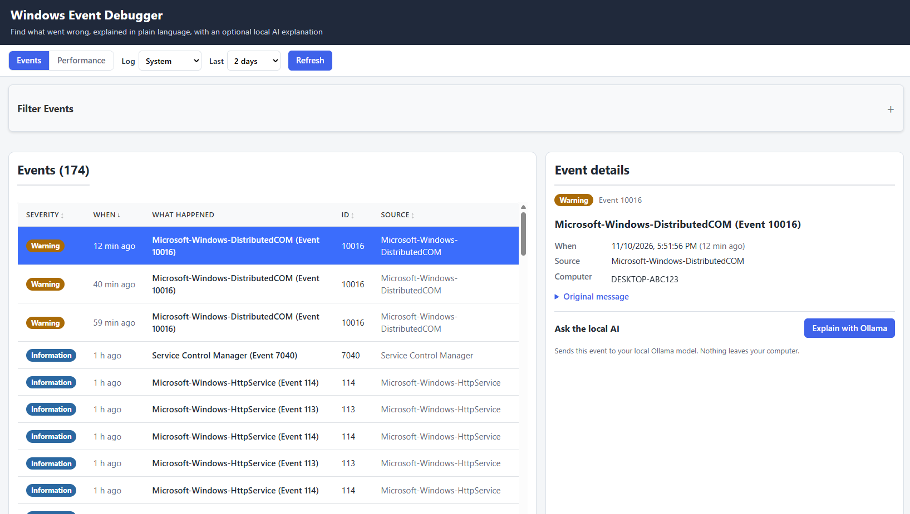
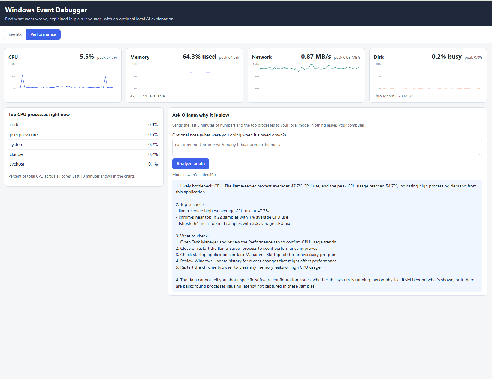

# CrashLens

A local, readable dashboard for figuring out why your Windows PC crashed, froze, or got slow.
It reads your real Windows event logs and live performance counters, explains them in plain
language, and can ask a local AI model (through [Ollama](https://ollama.com)) to walk you through
the likely cause. Everything runs on your computer.

## Screenshots

**Events:** real System log entries in plain language, with severity badges and a detail panel.



**Performance:** CPU, memory, network, and disk over the last 10 minutes, with top processes and
an Ollama analysis of the slowdown.



## Why it's cool

- **Plain English instead of Event Viewer walls of text.** Common event IDs get a title and a
  short explanation, such as "Unexpected shutdown (power loss or crash)" for event 41.
- **Crash spotting.** Events that look crash-related (bugchecks, unexpected shutdowns, app crashes,
  critical errors) get flagged, so you can start where it matters.
- **Performance graphs next to the events.** CPU, memory, network, and disk over the last 10 minutes,
  plus the processes using the most CPU right now. A spike in the graph at the same time as a crash
  event is often the clue you need.
- **One-click AI help.** "Explain with Ollama" describes a single event, and "Troubleshoot slowness"
  looks at the last 5 minutes of numbers and suspects a bottleneck.
- **Private by design.** No cloud service, no account, no telemetry. The AI model runs on your PC.
- **Starts with Windows.** Once set up, it's already running when you want to look at it.

## Requirements

- Windows 10 or 11
- [Node.js](https://nodejs.org) (LTS version)
- [Ollama](https://ollama.com) running locally, with at least one model pulled, for example:
  ```
  ollama pull qwen3-coder:30b
  ```
  A smaller model such as `qwen2.5vl:7b` also works. Use `OLLAMA_MODEL` to pick one (see below).

## Quick start

1. Download or clone this project.
2. Double-click **`start.bat`**. The first run installs dependencies, which takes a minute.
3. Two windows open (the API and the UI), and your browser opens http://localhost:3000.

Close the two **CrashLens** windows to stop it.

## Start automatically at login

The app can start quietly when you sign in to Windows, with no windows or browser tab.

- Run `start.bat --quiet` once to test it. It launches minimized, with no browser.
- To enable it at login, create a shortcut to `start.bat` with the argument `--quiet` in
  your Startup folder. Press `Win + R`, type `shell:startup`, and put the shortcut there.
  (The setup for this project already created one, named `CrashLens.lnk`.)
- To disable it, delete that shortcut from the Startup folder.

Note: this starts at **sign-in**, not at the very first power-on before you log in.

## Configuration

Set these environment variables before starting, if you need to change the defaults:

| Variable | Default | Purpose |
| --- | --- | --- |
| `OLLAMA_MODEL` | `qwen3-coder:30b` | Model used for the explanations |
| `OLLAMA_URL` | `http://localhost:11434` | Where Ollama is listening |
| `PORT` | `4000` | Port for the backend API |

## How it works

```
Browser (React, port 3000)
   │  /api/*  (forwarded by the dev server)
   ▼
Backend (Node.js, port 4000, 127.0.0.1 only)
   ├─ Event logs      ── PowerShell Get-WinEvent
   ├─ Performance     ── one PowerShell process reading Windows counters every 2 s
   └─ AI analysis     ── HTTP to your local Ollama
```

- The backend uses only built-in Node.js modules, so there are no extra server packages.
- It listens on `127.0.0.1` only, so other computers on your network can't reach it.

## Privacy

- Event log data and performance numbers stay on your computer.
- When you click an AI button, the event or performance summary goes to **your local Ollama**
  only. Nothing is sent to a cloud service.
- The project contains no personal data, keys, or machine-specific settings.

## Troubleshooting

- **Events show "Showing demo data".** The backend isn't running or can't be reached. Start it with
  `npm run server`, then click **Refresh**.
- **Security log fails.** Reading the Security log usually requires an administrator. Start
  `start.bat` from an administrator terminal to read it.
- **"Could not reach Ollama".** Start Ollama and make sure the model in `OLLAMA_MODEL` is pulled.
- **Port already in use.** Another copy is still running. Close its windows, or end the process
  using ports 3000 or 4000.
- **Performance tab says data isn't available.** Wait about 10 seconds after the backend starts.
  The sampler needs a few samples before the charts fill in.

## Development

```
npm run server   # backend API on port 4000
npm start        # web UI on port 3000
npm run build    # production build into build/
```

Project layout:

```
server/index.js        API routes, event logs, Ollama calls
server/metrics.js      background performance sampler
src/App.tsx            layout, tabs, data loading
src/components/        event list, event detail, filters, performance charts
src/knownEvents.ts     plain-language titles for common event IDs and crash detection
start.bat              one-click launcher (use --quiet for login startup)
```

## Contributing

Add more event IDs to `src/knownEvents.ts`. Each entry needs a title, a plain-language explanation,
and an optional `crashRelated` flag.

## License

Proprietary. All rights reserved. See [LICENSE](LICENSE). No permission is granted to copy,
modify, or redistribute this software without the author's written permission.
